<style>
.gfm-alert { border-left: .3em solid var(--a-c); background: var(--a-bg); border-radius: 4px; padding: .4em 1em; margin: .6em 0; font-size: .9em; }
.gfm-alert-title { color: var(--a-c); font-weight: 700; text-transform: uppercase; letter-spacing: .03em; font-size: .78em; margin: 0 0 .25em; }
.gfm-alert p:last-child { margin: 0; }
.gfm-note { --a-c: #1a73e8; --a-bg: #e3f2fd; }
.gfm-tip { --a-c: #2e7d32; --a-bg: #e8f5e9; }
.gfm-important { --a-c: #7b1fa2; --a-bg: #f3e5f5; }
.gfm-warning { --a-c: #e65100; --a-bg: #fff3e0; }
.gfm-caution { --a-c: #c62828; --a-bg: #fce4ec; }
</style>

<!-- _class: lead -->
<!-- _paginate: false -->

# Context Engineering
## From Prompt Engineering to Context Engineering

**Day 1 - Session 1**


---

# What We'll Cover

1. Extending prompt design to the agentic environment
2. How the Claude Code loop shapes working context
3. Context bloat, recall degradation, and focus
4. Demo: Comparing noisy and focused context payloads
5. Demo: Multi-turn tool output growth in an agent loop

---

<!-- _class: divider -->

# Extending Prompt Design

## Shaping the full information environment


---

# Prompt Design Remains the Foundation

- **Clear task phrasing:** Defines the goal, scope, and expected output
- **Explicit constraints:** Names files, interfaces, and boundaries to preserve
- **Context extension:** Applies those same principles across every turn
- **Working set curation:** Controls what enters and stays in the window

---

# Prompt Engineering vs. Context Engineering

| Dimension | Prompt Engineering | Context Engineering |
| :--- | :--- | :--- |
| **Scope** | Single request or static prompt | Full runtime state across turns |
| **Inputs** | Wording and few-shot examples | Guides, files, tools, and memory |
| **Failure mode** | Ambiguous task specification | Noisy dumps and competing rules |
| **Control unit** | Clauses in one message | Tokens entering at each step |

---

# From Single-Turn Prompts to Agentic Context



---

<!-- _class: divider -->

# The Agentic Context Loop

## How tool actions change the working set


---

# How Claude Code Builds Working Context

- **Gather context:** Searches paths and reads targeted source files
- **Take action:** Edits code or executes commands in the workspace
- **Verify results:** Runs tests and inspects compiler or linter output
- **Accumulate state:** Appends every tool result to the active window

---

# The Iterative Context Loop



---

# Unfiltered Tool Outputs Cause Bloat

```bash
# Unbounded test run floods the window with 400 passing traces
pytest -vv --tb=long

# Bounded test run returns only the failing assertion and summary
pytest tests/settlement/test_rounding.py -q --tb=short
```

> Bounding command output keeps diagnostic evidence while avoiding thousands of low-signal lines.

---

<!-- _class: demo -->

# Demo: Noisy vs. Focused Context Payloads

Run `python3 day1/demos/demo-noisy-vs-focused-context.py`.

- **Payload composition:** Compare a noisy dump against a focused payment task
- **Signal distribution:** Inspect how verbose logs crowd out project rules
- **Constraint distance:** Observe token separation between rules and active edits
- **Verification check:** Review how acceptance criteria catch missed invariants

> Runs locally with synthetic fixtures; pair with `/context` in Claude Code for live inspection.

---

<!-- _class: divider -->

# Context Rot, Recall, and Trust

## Managing signal, noise, and untrusted inputs


---

# Understanding Context Rot Accurately

- **Attention dilution:** Low-signal tokens compete with project constraints
- **Reduced recall:** Earlier conventions become harder to retrieve reliably
- **Not a guaranteed hallucination:** Larger context does not force fabrication
- **Measured impact:** Evaluate adherence on the actual task and test suite

---

# Quick Check: Diagnosing a Missed Rule

A developer pipes 4,000 lines of test logs into a session, and Claude edits a payment module using `float` instead of `Decimal`. What should you check first?

1. Whether the model temperature was set too high
2. Whether `CLAUDE.md` specifies `Decimal` and how much noise sits in context
3. Whether the repository needs a vector database

---

# Quick Check: Answer and Reasoning

- **Best answer:** Option 2 (check `CLAUDE.md` clarity and context noise)
- **Why:** Missing or diluted invariants explain rule violations in long logs
- **Rejected options:** Temperature or vector stores do not fix noisy tool dumps
- **Next step:** Re-run with a concise test command and explicit project rule

---

# Trust Boundaries in Retrieved Content

- **Untrusted evidence:** Issue text, logs, and READMEs are data, not authority
- **Prompt injection risk:** Retrieved comments must not override system rules
- **Data minimization:** Redact secrets and use synthetic records in class
- **Platform controls:** Enforce access at the repository and credential layer

<div class="gfm-alert gfm-caution">
<div class="gfm-alert-title">Caution</div>
<p>Search exclusions reduce noise, but they are not a security or confidentiality boundary.</p>
</div>

---

<!-- _class: demo -->

# Demo: Multi-Turn Agent Loop Context Growth

Run `python3 day1/demos/demo-agent-loop-context-growth.py`.

- **Turn-by-turn growth:** Track context accumulation across six agent turns
- **Unbounded vs. bounded:** Compare broad directory scans with targeted queries
- **Artifact pollution:** See how un-ignored `dist/` files mislead later edits
- **Remediation pattern:** Apply path filters and concise flags at each step

> Illustrates multi-turn payload growth; verify live window state with `/context`.

---

# Key Takeaways

1. Context engineering extends prompt design across instructions, files, tool outputs, and memory.
2. Every file read, search match, and test run in an agentic loop adds tokens to the working window.
3. Excessive or irrelevant context can reduce recall and focus without guaranteeing hallucination.
4. Retrieved files and logs are untrusted evidence that require bounded queries and verification tests.

---

<!-- _class: lead -->
<!-- _paginate: false -->

# Questions?

**Next up: Session 2 - How Claude Code Manages Context**


