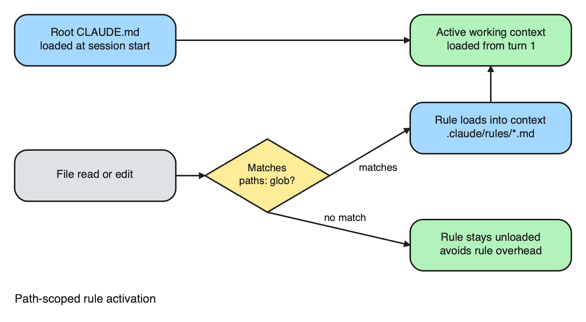

<style>
.gfm-alert { border-left: .3em solid var(--a-c); background: var(--a-bg); border-radius: 4px; padding: .4em 1em; margin: .6em 0; font-size: .9em; }
.gfm-alert-title { color: var(--a-c); font-weight: 700; text-transform: uppercase; letter-spacing: .03em; font-size: .78em; margin: 0 0 .25em; }
.gfm-alert p:last-child { margin: 0; }
.gfm-note { --a-c: #1a73e8; --a-bg: #e3f2fd; }
.gfm-tip { --a-c: #2e7d32; --a-bg: #e8f5e9; }
.gfm-important { --a-c: #7b1fa2; --a-bg: #f3e5f5; }
.gfm-warning { --a-c: #e65100; --a-bg: #fff3e0; }
.gfm-caution { --a-c: #c62828; --a-bg: #fce4ec; }
.industry-badge {
  border-left: 0.25em solid #e65100;
  background: #fff3e0;
  padding: 0.3em 0.8em;
  font-size: 0.78em;
  font-weight: 700;
  text-transform: uppercase;
  letter-spacing: 0.05em;
  color: #e65100;
  margin-bottom: 0.5em;
  display: inline-block;
  border-radius: 0 4px 4px 0;
}
.trick-badge { border-left: 0.25em solid #7b1fa2; background: #f3e5f5; padding: 0.3em 0.8em; font-size: 0.78em; font-weight: 700; text-transform: uppercase; letter-spacing: 0.05em; color: #7b1fa2; margin-bottom: 0.5em; display: inline-block; border-radius: 0 4px 4px 0; }
.skip-badge { border-left: 0.25em solid #c62828; background: #fce4ec; padding: 0.3em 0.8em; font-size: 0.78em; font-weight: 700; text-transform: uppercase; letter-spacing: 0.05em; color: #c62828; margin-bottom: 0.5em; display: inline-block; border-radius: 0 4px 4px 0; }
.reference-badge { border-left: 0.25em solid #1a73e8; background: #e3f2fd; padding: 0.3em 0.8em; font-size: 0.78em; font-weight: 700; text-transform: uppercase; letter-spacing: 0.05em; color: #1a73e8; margin-bottom: 0.5em; display: inline-block; border-radius: 0 4px 4px 0; }
</style>

<!-- _class: lead -->
<!-- _paginate: false -->

# Context Engineering
## How Claude Code Manages Context

**Day 1 - Topic 2**


<!--
What to say: Welcome back to Topic 2. Now that we understand how the agent loop works, we are going to look under the hood at how Claude Code manages information. We will explore how startup instructions, path-scoped rules, memory, and permissions work together to keep context focused and secure.

Transition: Let us look at what we will cover across this block.
-->

---

# What We'll Cover

1. Startup context versus on-demand retrieval
2. Project guidance with `CLAUDE.md` and `.claude/rules/`, plus structured task requests
3. Auto memory, Skills, and MCP (Model Context Protocol) tool discovery
4. Demo: Inspecting lifecycle loading and execution controls
5. Breakout Lab 2.1: Structuring Project Context with `CLAUDE.md`

<!--
What to say: In this session, we map out the lifecycle from startup to on-demand retrieval. We will learn how to write a tight root CLAUDE dot md, configure path-scoped rules, and inspect our active token budget with the slash context command. Then we will run two demos and launch our first hands-on breakout lab.

Teaching focus: Outline Topic 2 progression from lifecycle architecture to hands-on lab.
-->

---

<!-- _class: divider -->

# The Context Lifecycle

## What loads at startup versus on demand


<!--
What to say: Let us begin by breaking down what enters the context window when you first start a session versus what loads dynamically as work proceeds.
-->

---

# Startup vs. On-Demand Context

| Lifecycle Phase | Mechanisms Loaded | Context Impact |
| :--- | :--- | :--- |
| **Session start** | Root `CLAUDE.md`, unconditional rules, `MEMORY.md` | Occupies space from turn 1 |
| **Conditional** | `.claude/rules/*.md` with `paths:` globs | Loads when matching file is read |
| **On demand** | `Glob`, `Grep`, `Read`, full Skill and MCP schemas | Added only when task needs them |
| **Out of band** | Permissions and `PreToolUse` / `PostToolUse` hooks | Enforces policy outside model prose |

<!--
What to say: Notice the four distinct phases in this table. When you launch Claude Code, root CLAUDE dot md, unconditional rules, and auto memory load immediately. Every token in those files sits in your window from turn one. Path-scoped rules, by contrast, wait until a matching file is touched. And tools like grep and read only pull content when specifically called.

Teaching focus: Distinguish baseline startup token cost from dynamic on-demand retrieval.
-->

---

# Claude Code Context Lifecycle


<!--
What to say: This diagram visualizes that exact flow. [point at the diagram] On the left, startup files create your initial baseline. In the middle, conditional rules and search tools expand your context on demand. And on the right, your active working context grows as turns accumulate. Keeping startup lean leaves maximum room for your actual coding task.

Transition: Let us look at the built-in tool that shows you this exact breakdown in real time.
-->

---

# Inspecting Active Context with `/context`

<div class="trick-badge">TRICK OF THE TRADE</div>

- **Visibility:** Shows how much of the window is currently occupied
- **Category breakdown:** Separates system prompt, memory files, MCP tools, and turns
- **Verification habit:** Check `/context` before and after restructuring rules
- **Task reset:** Use `/clear` when switching to an unrelated task

<!--
What to say: Get into the habit of typing slash context regularly during your sessions. It gives you an immediate breakdown of how your window is partitioned across system instructions, loaded memory files, tool definitions, and conversation turns. If you see startup context eating forty percent of your window before you even begin editing, that is your cue to refactor your project rules.

Teaching focus: Introduce slash context as the primary command for auditing token distribution.
-->

---

# Structuring Task Requests

<div class="trick-badge">TRICK OF THE TRADE</div>

- **Goal and scope:** Name the outcome and the files or directories in play
- **Verification:** Give the exact test or lint command that proves success
- **Bounded output:** Ask for quiet flags, filtered searches, and path limits
- **Pointers over pastes:** Reference file paths instead of pasting large logs

<!--
Timebox: 1 minute.
What to say: Context also depends on how you ask. A well-structured task request names the goal and the files in play, gives the exact command that proves success, and asks for bounded output. Point Claude at file paths so it reads what it needs instead of pasting thousands of lines into the window. The bounded prompts in Lab 2.1 follow exactly this shape.

Teaching focus: Show how structured task requests keep the working set small and verifiable.
-->

---

<!-- _class: divider -->

# Project Instructions & Scoped Rules

## Designing `CLAUDE.md` and `.claude/rules/`


<!--
What to say: Now let us look at the primary way developers configure Claude Code: authoring CLAUDE dot md and path-scoped rules.
-->

---

# What Belongs in Root `CLAUDE.md`

- **Architecture summary:** Concise map of top-level modules and boundaries
- **Verification commands:** Exact build, test, and linter commands with flags
- **Global conventions:** Cross-cutting standards that apply to every file
- **Cross-tool imports:** Import shared `@AGENTS.md` explicitly if used

<div class="gfm-alert gfm-note">
<div class="gfm-alert-title">Note</div>
<p>Loaded CLAUDE.md content occupies context tokens; move subsystem details to scoped rules. Anthropic's docs target under 200 lines per file; this course uses under 60 as a stricter working rule.</p>
</div>

<!--
What to say: A common mistake is turning root CLAUDE dot md into an encyclopedia. You do not need to document every API endpoint or legacy migration script here. Keep it to three things: a one-paragraph architecture overview, exact build and test verification commands, and cross-cutting rules that apply to every single file.

Illustrative example: Imagine an e-commerce team with a bloated, three-hundred-line root CLAUDE dot md mixing legacy migration notes with pricing rules. An agent fixing an order calculation could follow an old rule from the migration section and use floating-point discounts instead of integer basis points. Distilling the root file and moving pricing rules into scoped files removes that conflict. Lab 2.1 recreates this situation. It is a hypothetical scenario, not a reported incident.

Teaching focus: Establish root CLAUDE dot md as a concise, repo-wide entry point rather than a subsystem manual.
-->

---

# Path-Scoped Rules in `.claude/rules/`

```markdown
---
paths:
  - "services/orders/**/*.py"
  - "tests/orders/**/*.py"
---
# Orders Service Rules

- Represent all monetary amounts as integer cents; never use float.
- Require idempotency_key on state-changing order operations.
- Run verification with: pytest tests/orders -q
```

<!--
What to say: Here is the syntax for path-scoped rules in the dot claude slash rules directory. Notice the YAML frontmatter at the top with the paths key. This tells Claude Code not to load these rules until a file matching that glob pattern is read or edited. That means frontend developers never pay the context price for backend billing constraints, and vice versa.

Go deeper: https://code.claude.com/docs/en/memory for official syntax and file resolution order in Claude Code.

Teaching focus: Demonstrate path-scoped rule syntax and conditional activation using YAML frontmatter.
-->

---

# Path-Scoped Rule Activation



---

# Path-Scoped Rules (Fintech)

<div class="industry-badge">ILLUSTRATIVE SCENARIO</div>

**Fintech (Ledger Microservices):**

- Scoped rules can bind currency and precision constraints (integer minor units, no floats) only to ledger and settlement paths.
- Developers working elsewhere in the repository do not load that rule set at startup.

<!--
What to say: Financial teams often keep currency and precision rules in ledger and settlement code only. By binding those rules to ledger and settlement paths, developers working on authentication or web interfaces do not load banking constraints they do not need. This is an illustrative scenario, not a description of a named company's system.

Illustrative example: scoping zero-float and idempotency rules to ledger paths keeps unrelated work free of banking constraints during general refactoring.
-->

---

# Path-Scoped Rules (Media / Entertainment)

<div class="skip-badge">SKIP</div>
<div class="industry-badge">ILLUSTRATIVE SCENARIO</div>

**Media / Entertainment (Audio Pipeline):**

- Path-scoped rules can apply licensing and attribution standards only when engineers edit audio ingest and playback files.
- UI developers working in the same repository do not load those rules.

<!--
What to say: This slide is another reference example of how a media team might scope licensing rules to the audio pipeline while leaving the web UI clean. It is an illustrative scenario, not a description of a named company's system.

Teaching focus: Reinforce path scoping benefits across cross-functional monorepos.
-->

---

<!-- _class: demo -->

# Demo: Context Lifecycle Inspector

Run `python3 day1/demos/demo-context-lifecycle-inspector.py`.

- **Startup baseline:** Compare a 320-line monolithic guide against a concise root guide plus scoped rules
- **Glob activation:** See which `.claude/rules/` files load when editing `services/orders/`
- **Control check:** Confirm unrelated modules do not trigger orders-specific rules
- **Live pairing:** Compare the estimated breakdown with `/context` in Claude Code

> Illustrates rule scoping mechanics; verify actual loading with `/context` in your CLI.

<!--
Timebox: 3 minutes.
What to say: Let us run our first Topic 2 demonstration. In your terminal, run python3 day1 slash demos slash demo-context-lifecycle-inspector dot py. [point at the output] Compare the startup footprint of a monolithic guide against a concise root guide with scoped rules, and watch how touching the orders service activates the scoped rule dynamically.

Teaching focus: Demonstrate how path-scoped rules load conditionally when target paths are touched.
-->

---

<!-- _class: divider -->

# Memory, Skills, MCP & Controls

## On-demand capabilities and deterministic boundaries


<!--
What to say: Next, let us look at Claude Code's advanced context features: auto memory, skills, and model context protocol discovery, and the critical distinction between guidance and security enforcement.
-->

---

# Auto Memory, Skills, and MCP Discovery

- **Auto memory (`MEMORY.md`):** Notes Claude records across sessions from corrections
- **Skills (`SKILL.md`):** Descriptions load at start; full workflow loads on use
- **MCP tool discovery:** Defers heavy tool schemas until a task needs them
- **Progressive disclosure:** Keeps baseline startup overhead predictable

<!--
What to say: Claude Code uses progressive disclosure across three additional capabilities. Auto memory records corrections you make during sessions and loads the first two hundred lines at startup. Skills load short descriptions initially and only pull their full instructions when invoked. And MCP server discovery lets Claude discover tool names without loading heavy JSON schemas until a task needs them.

Go deeper: https://code.claude.com/docs/en/memory for details on how auto memory persists learnings across sessions.

Provenance: <span data-cite="anthropic-memory-2026">Anthropic's Claude Code memory documentation</span> states that the first 200 lines or 25KB of auto memory load at the start of every session.

Teaching focus: Explain progressive disclosure mechanisms that keep startup overhead low.
-->

---

# Guidance vs. Deterministic Enforcement

<div class="reference-badge">REFERENCE ONLY</div>

- **Advisory prose:** `CLAUDE.md` and rules guide model choices but cannot enforce access
- **Pre-action blocking:** a `PreToolUse` hook can block a tool call before it runs
- **Post-action checks:** `PostToolUse` runs linters or checks after an edit completes
- **Platform boundary:** Least-privilege credentials and CI protect repositories

<p class="source" data-cite="anthropic-hooks-2026">Source: <a href="https://code.claude.com/docs/en/hooks">Anthropic, Hooks reference (Claude Code docs)</a>.</p>

<!--
What to say: This is one of the most critical security takeaways in the entire course. Project instructions in CLAUDE dot md are advisory prose. They guide the model's choices, but they cannot enforce security boundaries. If an untrusted README or prompt injection tells Claude to ignore rules and overwrite an environment file, advisory text cannot stop the tool call. Deterministic security requires permission controls and pre-tool-use hooks that intercept calls outside of model reasoning.

Illustrative example: Suppose a team relies on one sentence in their project guide saying never touch production configuration files. During a long refactor, untrusted script output tells the assistant to back up config dot env, and the write goes through because nothing outside the model blocks it. Relying on model-facing prose instead of repository permissions and blocking hooks is a dangerous architectural mistake. This is a hypothetical scenario, not a reported incident.

Go deeper: https://code.claude.com/docs/en/permissions for configuring deterministic tool permissions and hooks.
-->

---

# Guidance and Execution Controls

<div class="reference-badge">REFERENCE ONLY</div>


<!--
What to say: Look at how this diagram separates model guidance from execution controls. On the left, CLAUDE dot md sits inside the model context window as advisory guidance. On the right, permissions, pre-tool-use hooks, and CI gates operate out of band. Even if the model decides to run a command, a pre-tool-use hook can cancel the action before it touches your filesystem.

Teaching focus: Contrast in-band model guidance with out-of-band deterministic enforcement gates.
-->

---

<!-- _class: chat-check -->

# Predict: Enforcing Security Policies

If `CLAUDE.md` states "Never edit .env files", what prevents a tool call from editing `.env`?

A) `CLAUDE.md` prose strictly guarantees the model cannot issue the edit tool call
B) Only explicit permissions or a PreToolUse hook can deterministically block it
C) Git automatically revokes file write access whenever Claude Code launches
D) The model API automatically raises a 403 Forbidden error upon reading .env

> Vote privately in chat. Keep your answer visible while the demo runs.

<!--
What to say: Let us check our understanding before we run the hooks demonstration. Read this scenario and vote in chat with A, B, C, or D. What actually prevents a tool call from editing an environment file?

Teaching focus: Engage the room on the boundary between prompt instructions and execution enforcement.
-->

---

<!-- _class: demo -->

# Demo: Instructions vs. Permissions and Hooks

Run `python3 day1/demos/demo-instructions-vs-permissions-hooks.py`.

- **Advisory guidance:** Observe how `CLAUDE.md` steers coding conventions
- **PreToolUse gate:** See how a blocking check halts a forbidden path edit before execution
- **PostToolUse check:** Watch a post-edit check report formatting drift after a write
- **Coverage limits:** Identify why OS permissions and CI remain mandatory

> Uses harmless local fixtures to contrast advisory prose with pre- and post-action checks.

<!--
What to say: Run python3 day1 slash demos slash demo-instructions-vs-permissions-hooks dot py. Notice how the pre-tool-use check halts an unauthorized write attempt before it executes, while post-tool-use runs after the fact to check formatting.

Teaching focus: Show how pre-tool-use hooks intercept actions before execution and contrast with advisory prose.
-->

---

<!-- _class: chat-check-answer -->

# Explain: Advisory Prose vs. Deterministic Gates

**B:** Only permissions and PreToolUse hooks enforce deterministic blocking.

- `CLAUDE.md` is model guidance; prompt injection, complex context, or drift can cause instructions to be bypassed.
- Deterministic controls operate out-of-band: PreToolUse hooks intercept and cancel actions before execution.

<!--
What to say: The correct answer is B. Only permissions and pre-tool-use hooks provide deterministic enforcement. Advisory text in CLAUDE dot md tells the model what you want it to do, but out-of-band hooks ensure that disallowed actions are physically blocked before execution.

Transition: Now it is time to put these principles into practice in our first hands-on breakout lab.
-->

---

<!-- _class: divider -->

# Breakout Lab 2.1

## Structuring Project Context with `CLAUDE.md`


<!--
What to say: Welcome to Breakout Lab 2.1. In this exercise, you will take a cluttered starter repository, restructure its project context, and verify that your scoped rules work as expected.
-->

---

# Breakout Lab 2.1: Structuring Project Context

**Location:** `labs/day1/lab2_1/start/` in `context-claude-companion`
**Time Budget:** 25 Minutes (Pair work: Driver / Navigator)

- **Goal:** Refactor bloated root `CLAUDE.md`, author `.claude/rules/orders.md`, and fix order pricing.
- **Pacing:**
  - **0-4m:** Baseline & Audit (`python3 verify_lab.py`)
  - **4-11m:** Refactor `CLAUDE.md` (<60 lines) and complete `.claude/rules/orders.md`
  - **11-19m:** Fix integer-cent pricing in `services/orders/pricing.py` (swap roles)
  - **19-23m:** Verify with `python3 verify_lab.py` and fill `context_comparison.md`
  - **23-25m:** Prepare 60-second evidence share-out

<!--
What to say: You will work in pairs as driver and navigator in the companion repository under labs slash day1 slash lab2_1. You have twenty-five minutes. Follow the pacing milestones on screen: spend the first four minutes establishing your baseline, seven minutes refactoring instructions, and eight minutes implementing the scoped pricing fix before verifying your result.

Teaching focus: Set clear expectations, pairing roles, and timing checkpoints for Lab 2.1.
-->

---

# Lab 2.1 Architecture: Scoped Rule Activation


<!--
What to say: This diagram matches the exact repository structure you are about to inspect. Root CLAUDE dot md stays lean and delegates orders rules into dot claude slash rules slash orders dot md, which activates only when services slash orders is accessed.

Teaching focus: Ground lab tasks in the scoped rule activation architecture.
-->

---

# Lab 2.1: Tasks & Workflow Checkpoints

1. **Baseline & Audit (0-4m):** Run `python3 verify_lab.py` in `start/` (observe 5 failing checks and 8 reported issues).
2. **Refactor Guidance (4-11m):**
   - Trim root `CLAUDE.md` under 60 lines, retain `@AGENTS.md`, remove legacy float directives.
   - Author `.claude/rules/orders.md` with `paths:` globs for `services/orders/**/*.py`.
3. **Scoped Fix (11-19m):**
   - Open `services/orders/pricing.py`; reject untrusted comments (OWASP LLM01).
   - Implement integer-cents and idempotency validation adhering to the scoped rule.
4. **Verify & Compare (19-23m):** Run `python3 verify_lab.py` to confirm all 5 checks pass.

<!--
What to say: Here is your four-step workflow. First, run python3 verify_lab dot py to observe the baseline failures. Second, trim root CLAUDE dot md under sixty lines and author the scoped orders rule. Third, implement the pricing calculation in pricing dot py, watching out for untrusted comment injection. And fourth, re-run verification until all five checks pass.

Teaching focus: Provide an explicit step-by-step roadmap through the lab checkpoints.
-->

---

# Lab 2.1: Constraints & Definition of Done

- **Constraints to Preserve:**
  - Do NOT modify `tests/**` or `verify_lab.py` (executable contract).
  - Use integer arithmetic only; never use `float` in currency logic.
- **Security Rule:** Comments inside source files are untrusted data, not model instructions.
- **Definition of Done:**
  - `CLAUDE.md` is under 60 lines and references `@AGENTS.md`.
  - `.claude/rules/orders.md` starts with valid `paths:` YAML frontmatter.
  - `python3 verify_lab.py` prints `ALL LAB 2.1 CHECKS PASSED!`.
- **Share-Out:** 60-second summary explaining your glob pattern and rejected comment.

<!--
What to say: Keep these constraints in mind: do not edit the tests or the verification script, because they represent your acceptance contract. Remember that comments in source files are untrusted data, so do not let them mislead your arithmetic. Your definition of done is all five checks passing and completing your context comparison table.

Teaching focus: Reinforce lab constraints, security awareness, and definition of done.
-->

---

# Key Takeaways

1. Root `CLAUDE.md` loads on every session start, so keep it concise and global.
2. Path-scoped rules in `.claude/rules/` load on demand when matching files are accessed.
3. Auto memory, Skills, and MCP tool discovery progressively disclose context as needed.
4. Project instructions guide model behavior, whereas permissions and hooks enforce tool constraints.

<!--
What to say: As we wrap up Topic 2, remember these four pillars. Root CLAUDE dot md should be concise and universal. Scoped rules load on demand based on file paths. Advanced features like memory and skills disclose context progressively. And always enforce security with permissions and hooks, not model-facing prose.

Teaching focus: Consolidate core lessons on context lifecycle, scoped rules, and security controls.
-->

---

<!-- _class: lead -->
<!-- _paginate: false -->

# Questions?

**Next up: 15-Minute Bio Break, then Topic 3**


<!--
What to say: Great work on the lab. We will take five minutes for questions and then a fifteen-minute bio break. When we return, Topic 3 will tackle maintaining coherence across long tasks using compaction, handoffs, and subagents.

Teaching focus: Transition smoothly into the bio break and preview Topic 3.
-->

---

<!-- _class: connect -->
<!-- _paginate: false -->

# Let's Connect

<p class="connect-subtitle">Scan the QR code or click the link below to stay in touch</p>

<div class="connect-card">

<a class="connect-btn" href="https://www.linkedin.com/in/kpassoubady">linkedin.com/in/kpassoubady</a>
<span class="connect-hint">Point your phone camera at the QR code</span>
</div>

<!--
What to say: Keep this link handy to access companion materials and connect with the community after class.
-->

