<style>
.gfm-alert { border-left: .3em solid var(--a-c); background: var(--a-bg); border-radius: 4px; padding: .4em 1em; margin: .6em 0; font-size: .9em; }
.gfm-alert-title { color: var(--a-c); font-weight: 700; text-transform: uppercase; letter-spacing: .03em; font-size: .78em; margin: 0 0 .25em; }
.gfm-alert p:last-child { margin: 0; }
.gfm-note { --a-c: #1a73e8; --a-bg: #e3f2fd; }
.gfm-tip { --a-c: #2e7d32; --a-bg: #e8f5e9; }
.gfm-important { --a-c: #7b1fa2; --a-bg: #f3e5f5; }
.gfm-warning { --a-c: #e65100; --a-bg: #fff3e0; }
.gfm-caution { --a-c: #c62828; --a-bg: #fce4ec; }
.industry-badge {
  border-left: 0.25em solid #e65100;
  background: #fff3e0;
  padding: 0.3em 0.8em;
  font-size: 0.78em;
  font-weight: 700;
  text-transform: uppercase;
  letter-spacing: 0.05em;
  color: #e65100;
  margin-bottom: 0.5em;
  display: inline-block;
  border-radius: 0 4px 4px 0;
}
.trick-badge { border-left: 0.25em solid #7b1fa2; background: #f3e5f5; padding: 0.3em 0.8em; font-size: 0.78em; font-weight: 700; text-transform: uppercase; letter-spacing: 0.05em; color: #7b1fa2; margin-bottom: 0.5em; display: inline-block; border-radius: 0 4px 4px 0; }
.skip-badge { border-left: 0.25em solid #c62828; background: #fce4ec; padding: 0.3em 0.8em; font-size: 0.78em; font-weight: 700; text-transform: uppercase; letter-spacing: 0.05em; color: #c62828; margin-bottom: 0.5em; display: inline-block; border-radius: 0 4px 4px 0; }
.reference-badge { border-left: 0.25em solid #1a73e8; background: #e3f2fd; padding: 0.3em 0.8em; font-size: 0.78em; font-weight: 700; text-transform: uppercase; letter-spacing: 0.05em; color: #1a73e8; margin-bottom: 0.5em; display: inline-block; border-radius: 0 4px 4px 0; }
</style>

<!-- _class: lead -->
<!-- _paginate: false -->

# Context Engineering
## Maintaining Coherence Across Long Tasks

**Day 1 - Session 3**


---

# What We'll Cover

1. Automatic versus focused compaction and summary limits
2. Durable task notes (`HANDOFF.md`) and fresh-session handoffs
3. Isolated subagents and direct file search versus RAG (Retrieval-Augmented Generation)
4. Demo: Auditing compaction summaries and handoff state
5. Breakout Lab 3.1: Context Compaction and State Handoffs

---

<!-- _class: divider -->

# Compaction & Durable Handoffs

## Carrying verified state across long workflows


---

# Automatic vs. Focused Compaction

- **Automatic compaction:** Summarizes older turns as the window approaches capacity
- **Focused `/compact`:** Accepts instructions on what state the summary should keep
- **Reloaded context:** Root `CLAUDE.md` and auto memory remain available
- **Lossy nature:** Exact line numbers, error codes, or rejected fixes can drop out

<div class="gfm-alert gfm-warning">
<div class="gfm-alert-title">Warning</div>
<p>Never assume a summary preserved every negative constraint; verify against disk and tests.</p>
</div>

---

# Durable Handoffs and Fresh Sessions

<div class="trick-badge">TRICK OF THE TRADE</div>

```markdown
# Task Handoff: Worker Lease Renewal
- Revision: commit 8f4a12c (modified: task_queue/lease.py)
- Goal: Prevent duplicate job execution on lease renewal
- Constraints: Keep LeaseManager signature; no external lock service
- Failed Approaches: Global mutex (failed test_concurrent_lease_renewal)
- Next Verification: Run pytest tests/test_lease.py -q
```

> Writing `HANDOFF.md` and running `/clear` resets history bloat while keeping explicit provenance.

---

# Compaction and Handoff Verification Flow



---

<!-- _class: chat-check -->

# Predict: Compaction Summary Vulnerability

What critical debugging detail is most prone to being lost during automatic compaction?

A) The high-level objective of the multi-turn session
B) The name of the primary programming language used
C) Specific rejected approaches, error traces, and exact modified line numbers
D) The overall pass/fail status of the final test command

> Vote privately in chat. Keep your answer visible while the demo runs.

---

<!-- _class: demo -->

# Demo: Compaction and Handoff Verifier

Run `python3 day1/demos/demo-compaction-and-handoff-verifier.py`.

- **Summary audit:** Compare an unfocused summary against actual repo files and tests
- **Dropped constraints:** Spot where a rejected fix was omitted from the summary
- **Drift detection:** Catch a stale file-state claim before editing code
- **Verified handoff:** Confirm `HANDOFF.md` aligns with `git status` and `pytest`

> Demonstrates why post-compaction and fresh-session work must re-verify repository state.

---

<!-- _class: chat-check-answer -->

# Explain: Information Loss in Summarization

**C:** Specific rejected approaches, error traces, and line numbers.

- Automatic summaries collapse history into high-level milestones, often omitting why a previous fix failed.
- A fresh session reading an unfocused summary may re-attempt the same flawed fix unless captured in `HANDOFF.md`.

---

<!-- _class: divider -->

# Subagents & Retrieval Patterns

## Isolating exploration and choosing retrieval tools


---

# Isolated Subagents for Exploration

- **Separate window:** Intermediate `Grep` and `Read` calls stay in the worker context
- **Synthesized return:** Parent session receives only the summarized findings and paths
- **Cost reality:** Total model usage spans both parent and subagent windows
- **Security boundary:** Context isolation is not filesystem or credential isolation

---

# Isolated Subagents (Fintech)

<div class="industry-badge">REAL-WORLD SCENARIO</div>

**Fintech (Robinhood - Multi-Account Audit & Reconciliation):**

- Dispatches subagents to audit hundreds of independent trading ledger logs in isolated windows, filtering millions of audit events down to mismatched balances.
- The parent orchestrator stays clean and responsive, receiving only flagged discrepancy IDs without context bloat from raw transaction streams.

---

# Isolated Subagents (Media / Entertainment)

<div class="skip-badge">SKIP</div>
<div class="industry-badge">REAL-WORLD SCENARIO</div>

**Media / Entertainment (Disney+ - Content Asset Catalog Ingestion):**

- Delegates deep media tag extraction across video, audio, and subtitle streams to temporary subagents running in isolated context windows.
- The main ingest orchestrator receives only standardized syndication manifests, preventing file schema bloat from exhausting memory during batch imports.

---

# Direct File Search vs. External RAG

| Retrieval Need | Local File Search (`Glob`, `Grep`, `Read`) | External RAG (Retrieval-Augmented Generation via MCP / Service) |
| :--- | :--- | :--- |
| **Target source** | Active codebase and working tree | Large external docs, ADRs, or tickets |
| **Freshness** | Immediate; zero indexing lag | Depends on index sync schedule |
| **Precision** | Exact symbol and line matching | Semantic or hybrid chunk retrieval |
| **Access control** | Local repo permissions | Must enforce tenant ACLs before context |

---

# Subagent Isolation and Retrieval Architecture



---

<!-- _class: demo -->

# Demo: Subagent Isolation vs. Inline Search

Run `python3 day1/demos/demo-subagent-isolation-vs-inline-search.py`.

- **Inline exploration:** Measure parent window growth across twelve module reads
- **Subagent delegation:** Observe how returning a synthesis keeps parent context lean
- **Total usage accounting:** Compare parent window size against combined token work
- **Retrieval selector:** Evaluate when local `Grep` beats an external RAG index

> Illustrates information flow between parent and subagent windows; not a sandbox test.

---

<!-- _class: divider -->

# Breakout Lab 3.1

## Context Compaction & State Handoffs


---

# Breakout Lab 3.1: Compaction & Handoffs

**Location:** `labs/day1/lab3_1/start/` in `context-claude-companion`
**Time Budget:** 25 Minutes (Pair work: Driver / Navigator)

- **Goal:** Audit lossy compaction summary, author durable `HANDOFF.md`, and resume in a fresh session.
- **Pacing:**
  - **0-4m:** Inspect & Test (`python3 verify_lab.py`)
  - **4-9m:** Audit `auto_compact_summary.md` against transcript
  - **9-15m:** Author `HANDOFF.md` with provenance and rejected fixes
  - **15-22m:** Fresh session (`/clear`), re-verify state, fix `task_queue/lease.py`
  - **22-25m:** Verify with `python3 verify_lab.py` and debrief

---

# Lab 3.1 Architecture: Compaction vs. Handoff


---

# Lab 3.1: Tasks & Workflow Checkpoints

1. **Inspect & Test (0-4m):** Run `python3 verify_lab.py` in `start/` (observe failing lease renewal test).
2. **Audit Flawed Summary (4-9m):**
   - Spot the omitted rejected approach (`global_threading_lock`).
   - Catch the false claim that `task_queue/dispatcher.py` was modified.
3. **Author Durable Handoff (9-15m):**
   - Fill `HANDOFF.md` with commit `8f4a12c`, failed approaches, and `/compact` directive.
   - Reject untrusted log hints suggesting disabling the sequence test.
4. **Fresh Session Resumption (15-22m):**
   - Clear session, verify disk state, and apply sequence token fix in `task_queue/lease.py`.
5. **Verify (22-25m):** Run `python3 verify_lab.py` to confirm all checks pass.

---

# Lab 3.1: Constraints & Definition of Done

- **Constraints to Preserve:**
  - Do NOT edit `tests/**`, `verify_lab.py`, or `task_queue/dispatcher.py`.
  - Do NOT add a global threading lock or alter default TTL.
- **Security Rule:** Disregard log hints advising test suppression (OWASP LLM01).
- **Definition of Done:**
  - `HANDOFF.md` includes commit `8f4a12c`, both rejected fixes, and summary drift findings.
  - `task_queue/lease.py` passes `tests/test_lease.py`.
  - `python3 verify_lab.py` outputs `ALL LAB 3.1 CHECKS PASSED!`.
- **Share-Out:** Two specific flaws identified during your summary audit.

---

# Key Takeaways

1. Automatic and focused `/compact` summaries are lossy and must be checked against files and tests.
2. Durable handoff notes paired with `/clear` let a fresh session resume without history bloat.
3. Subagents isolate intermediate search noise from the parent window but do not sandbox credentials.
4. Direct `Glob` and `Grep` fit local codebases, whereas RAG serves large access-controlled external corpora.

---

<!-- _class: lead -->
<!-- _paginate: false -->

# Questions?

**Next up: Kahoot Quiz 1, Break, and Session 4**


---

<!-- _class: lead -->
<!-- _paginate: false -->

# Let's Connect

**LinkedIn: <a href="https://www.linkedin.com/in/kpassoubady" style="color:#ffffff;">linkedin.com/in/kpassoubady</a>**


