<!-- _class: lead -->
<!-- _paginate: false -->

# Context Engineering
## Context Quality and Iteration

**Day 1 - Session 4**

---

# What We'll Cover

1. Identifying the five common context hazards
2. Repeatable before-and-after evaluation hierarchy
3. Using `/context`, `/cost`, and `/usage` accurately
4. Demo: Auditing a repository for context hazards
5. Demo: Scoring context variants across quality and cost

---

<!-- _class: divider -->

# Diagnosing Context Hazards

## What degrades instruction adherence over time

---

# Five Common Context Hazards

1. **Verbose tool results:** Unbounded logs and full-file dumps crowding the window
2. **Stale assumptions:** References to deleted paths or superseded migration steps
3. **Redundant rules:** Generic or duplicated prose obscuring specific invariants
4. **Context dilution:** Unscoped subsystem rules loading on every startup
5. **Conflicting instructions:** Root `CLAUDE.md` contradicting module rules or tests

---

# Mapping Context Hazards to Remediation

---

<!-- _class: demo -->

# Demo: Context Hazard Linter

Run `python3 day1/demos/demo-context-hazard-linter.py`.

- **Stale path check:** Detect references to non-existent directories in `CLAUDE.md`
- **Conflict detection:** Flag opposing test-runner and HTTP-client directives
- **Scoping audit:** Identify subsystem rule files missing `paths:` frontmatter
- **Remediation report:** Review concrete fixes before running evaluation tasks

> Static checks catch explicit fixture hazards; pair with human review and runtime tests.

---

<!-- _class: divider -->

# Evidence-Based Evaluation

## Quality gates first, efficiency metrics second

---

# Controlled Before-and-After Evaluation

| Evaluation Tier | Metric | Acceptance Requirement |
| :--- | :--- | :--- |
| **1. Correctness gate** | Automated test suite | 100% of unit and acceptance tests pass |
| **2. Adherence gate** | Project invariant checklist | All mandatory rules followed in the diff |
| **3. Safety gate** | Boundary and injection checks | Zero unauthorized actions or leaks |
| **4. Efficiency measure** | `/context`, `/cost`, turns | Compare only when gates 1 to 3 pass |

---

# The Context Evaluation Pipeline

---

# Why Fewer Tokens Alone Do Not Prove Quality

- **The false economy trap:** Stripping rules cuts tokens but increases regressions
- **Skipped verification:** Fewer turns may mean the agent skipped running tests
- **Telemetry precision:** Distinguish `/context` window state from `/cost` session usage
- **Honest reporting:** Record unavailable account metrics as `N/A`, never zero

Important

Reject any context optimization that fails a correctness, adherence, or security gate.

---

<!-- _class: demo -->

# Demo: Context A/B/C Scorecard Evaluator

Run `python3 day1/demos/demo-context-ab-evaluator.py`.

- **Variant A (Bloated baseline):** High context footprint and failed rule adherence
- **Variant B (Over-trimmed):** Lowest token count, but fails tests and safety gates
- **Variant C (Engineered):** Passes all correctness and adherence gates with lower cost
- **Decision rule:** See how the evaluator automatically rejects the false economy

> Uses labeled synthetic benchmark fixtures to demonstrate the evaluation decision rule.

---

# Key Takeaways

1. Audit context configurations regularly for verbose dumps, stale paths, redundancy, dilution, and conflicts.
2. Evaluate context changes against a pinned baseline using the same task prompt, commit, and tools.
3. Treat task correctness, instruction adherence, and safety boundaries as mandatory primary gates.
4. Use `/context`, `/cost`, and turn counts as supporting efficiency measures only after quality gates pass.

---

<!-- _class: lead -->
<!-- _paginate: false -->

# Questions?

**Next up: Mandatory Course Survey and Course Wrap-up**

