<!-- _class: lead -->
<!-- _paginate: false -->

# Context Engineering
## Context Quality and Iteration

**Day 1 - Session 4**

<!--
What to say: Welcome to our fourth and final session. Now that we know how to configure and isolate context, we need to know whether our changes actually improve performance. In this session, we will look at how to audit your repositories for context hazards and establish an evidence-based evaluation pipeline.

Transition: Let us look at what we will cover in this closing block.
-->

---

# What We'll Cover

1. Identifying the five common context hazards
2. Repeatable before-and-after evaluation hierarchy
3. Using `/context`, `/cost`, and `/usage` accurately
4. Demo: Auditing a repository for context hazards
5. Demo: Scoring context variants across quality and cost

<!--
What to say: We will start by diagnosing the five classic context hazards that cause instruction drift over time. Then we will establish a strict evaluation hierarchy where test correctness and rule adherence come first, and token cost comes second. We will walk through two diagnostic demos and build your personal transfer plan for Monday morning.

Teaching focus: Outline Session 4 topics covering hazard diagnostics, evaluation gates, and engineering transfer.
-->

---

<!-- _class: divider -->

# Diagnosing Context Hazards

## What degrades instruction adherence over time

<!--
What to say: Let us begin by examining what actually goes wrong in real project configurations as repositories grow.
-->

---

# Five Common Context Hazards

1. **Verbose tool results:** Unbounded logs and full-file dumps crowding the window
2. **Stale assumptions:** References to deleted paths or superseded migration steps
3. **Redundant rules:** Generic or duplicated prose obscuring specific invariants
4. **Context dilution:** Unscoped subsystem rules loading on every startup
5. **Conflicting instructions:** Root `CLAUDE.md` contradicting module rules or tests

<!--
What to say: Over time, repositories accumulate five classic context hazards. Verbose tool results dump thousands of lines into the window. Stale assumptions reference deleted paths. Redundant rules repeat generic advice like write clean code that dilutes your real invariants. Context dilution loads unrelated subsystem rules. And conflicting instructions leave the model choosing between opposing directives.

Real-world example: A platform team noticed Claude Code intermittently writing synchronous requests calls inside an async FastAPI microservice, even though their guide said to use async httpx. An audit revealed that their root CLAUDE dot md was four hundred lines long and still had an old legacy services snippet showing synchronous requests as the retry template. Removing the conflict and scoping httpx to the API service brought test pass rates from three out of five to a perfect five out of five.

Teaching focus: Identify the five common context hazards and explain their impact on instruction adherence.
-->

---

# Mapping Context Hazards to Remediation

<!--
What to say: This diagram connects each hazard to its failure mode and specific fix. [point at the diagram] If you have verbose outputs, bound your test commands. If you have stale paths, audit your guide against disk. If you have dilution or conflicts, extract those rules into path-scoped files in dot claude slash rules.

Teaching focus: Provide an actionable remediation path for each of the five context hazards.
-->

---

<!-- _class: demo -->

# Demo: Context Hazard Linter

Run `python3 day1/demos/demo-context-hazard-linter.py`.

- **Stale path check:** Detect references to non-existent directories in `CLAUDE.md`
- **Conflict detection:** Flag opposing test-runner and HTTP-client directives
- **Scoping audit:** Identify subsystem rule files missing `paths:` frontmatter
- **Remediation report:** Review concrete fixes before running evaluation tasks

> Static checks catch explicit fixture hazards; pair with human review and runtime tests.

<!--
What to say: Let us run our first Session 4 demonstration. Run python3 day1 slash demos slash demo-context-hazard-linter dot py. [point at the output] Notice how the linter scans CLAUDE dot md and rule files to detect missing directories, conflicting test directives, and un-scoped component rules before you ever launch an agent task.

Teaching focus: Demonstrate static auditing of project instructions to catch configuration hazards early.
-->

---

<!-- _class: divider -->

# Evidence-Based Evaluation

## Quality gates first, efficiency metrics second

<!--
What to say: Now let us turn to evaluation. How do we scientifically prove that a context optimization made our agent better rather than just cheaper?
-->

---

# Controlled Before-and-After Evaluation

REFERENCE ONLY

| Evaluation Tier | Metric | Acceptance Requirement |
| :--- | :--- | :--- |
| **1. Correctness gate** | Automated test suite | 100% of unit and acceptance tests pass |
| **2. Adherence gate** | Project invariant checklist | All mandatory rules followed in the diff |
| **3. Safety gate** | Boundary and injection checks | Zero unauthorized actions or leaks |
| **4. Efficiency measure** | `/context`, `/cost`, turns | Compare only when gates 1 to 3 pass |

<!--
What to say: This table defines our evaluation hierarchy. Notice the strict tiering. Tier one is correctness: automated tests must pass. Tier two is adherence: mandatory architectural invariants must be followed in the git diff. Tier three is safety: boundary and injection checks must hold. Only after tiers one through three pass do you look at tier four, which is token cost and turn count.

Teaching focus: Enforce the rule that correctness, adherence, and safety gates must pass before evaluating token efficiency.
-->

---

# Controlled Context Evaluation (Fintech)

REAL-WORLD SCENARIO

**Fintech (Adyen - Payment Processing Evaluation):**

- Evaluates agent context modifications using strict merchant transaction test suites as the primary gate before comparing token savings.
- Proves that pruning verbose API definitions reduced session token usage by 38% while maintaining 100% adherence to PCI-DSS data-handling rules.

<!--
What to say: Payment platforms like Adyen evaluate context modifications with the exact same rigor as payment gateway code. Before adopting an optimized API context payload, they require one hundred percent pass rates across merchant transaction test suites.

Real-world example: Pruning verbose API definitions cut session token usage by thirty-eight percent while maintaining one hundred percent adherence to PCI data handling standards, proving you can improve efficiency without compromising compliance.

Go deeper: https://code.claude.com/docs/en/features-overview for details on native telemetry and session monitoring.
-->

---

# Controlled Context Evaluation (Media / Entertainment)

SKIP

REAL-WORLD SCENARIO

**Media / Entertainment (Warner Bros. Discovery - Streaming Metadata Pipeline):**

- Validates context optimizations against catalog syndication schemas, verifying all genre tags and rating guidelines pass before measuring turn counts.
- Discovered that cutting too much schema context saved 20% in tokens but increased downstream ingestion re-tries by 45%.

<!--
What to say: This slide is another reference example from streaming media syndication, showing that cutting too much schema context saved twenty percent in tokens but increased downstream ingestion failures by forty-five percent.

Teaching focus: Reinforce that over-trimming context introduces expensive downstream regressions.
-->

---

# The Context Evaluation Pipeline

<!--
What to say: This diagram illustrates a controlled A B evaluation pipeline. You pin the exact baseline commit and task prompt, apply your context change, run your automated test gates, verify instruction adherence, and only then record token savings. If the tests fail, you reject the change immediately.

Teaching focus: Map out the step-by-step controlled evaluation pipeline.
-->

---

# Why Fewer Tokens Alone Do Not Prove Quality

- **The false economy trap:** Stripping rules cuts tokens but increases regressions
- **Skipped verification:** Fewer turns may mean the agent skipped running tests
- **Telemetry precision:** Distinguish `/context` window state from `/cost` session usage
- **Honest reporting:** Record unavailable account metrics as `N/A`, never zero

Important

Reject any context optimization that fails a correctness, adherence, or security gate.

<!--
What to say: Beware of the false economy trap. If someone tells you they cut token consumption by sixty percent, your immediate question must be: did the tests still pass? Anyone can reduce tokens by deleting error handling instructions and telling the model to skip running tests. That is not an optimization; it is an engineering regression.

Real-world example: An engineering team trimmed their project guide to five lines and told developers to prompt Claude to fix bugs in one turn without reading extra files. Token spend dropped by fifty percent, but regressions in production spiked because the agent stopped verifying edge cases and omitted tenant isolation checks.

Go deeper: https://www.anthropic.com/research/effective-context-engineering-for-ai-agents for Anthropic's methodology on measuring task accuracy alongside context efficiency.
-->

---

<!-- _class: chat-check -->

# Check: The False Economy of Context Trimming

If Variant B cuts context tokens by 40% but introduces a 5% unit test regression:

A) Adopt Variant B immediately because token reduction is the primary KPI
B) Reject Variant B; efficiency gains are invalid if correctness gates fail
C) Increase the prompt temperature to compensate for missing test context
D) Remove the failing unit tests so the pipeline reports 100% adherence

> Vote privately in chat. What principle governs this decision?

<!--
What to say: Let us check our understanding with this scenario. If Variant B cuts context tokens by forty percent but causes a five percent unit test regression, what do you do? Vote in chat with A, B, C, or D.

Teaching focus: Test the room's commitment to prioritizing correctness gates over token savings.
-->

---

<!-- _class: chat-check-answer -->

# Debrief: Quality Gates Precede Token Savings

**B:** Reject Variant B; correctness and adherence gates must pass first.

- Context engineering treats token efficiency as a secondary optimization tier.
- A lean context that causes test failures or skips verification is an engineering regression, not an optimization.

<!--
What to say: The correct answer is B. You reject Variant B without hesitation. In professional software engineering, efficiency gains are completely invalid if correctness gates fail. A cheaper run that produces broken code is an expensive failure in disguise.

Transition: Let us see how an automated A B C scorecard enforces this exact decision rule.
-->

---

<!-- _class: demo -->

# Demo: Context A/B/C Scorecard Evaluator

Run `python3 day1/demos/demo-context-ab-evaluator.py`.

- **Variant A (Bloated baseline):** High context footprint and failed rule adherence
- **Variant B (Over-trimmed):** Lowest token count, but fails tests and safety gates
- **Variant C (Engineered):** Passes all correctness and adherence gates with lower cost
- **Decision rule:** See how the evaluator automatically rejects the false economy

> Uses labeled synthetic benchmark fixtures to demonstrate the evaluation decision rule.

<!--
What to say: Run python3 day1 slash demos slash demo-context-ab-evaluator dot py. [point at the output] Notice how Variant B has the lowest token count and fastest turns, but the evaluator flags it as rejected because it failed unit tests. Variant C wins because it passes every test while cutting context footprint by nearly half.

Teaching focus: Demonstrate how an evaluation scorecard automatically rejects over-trimmed false optimizations.
-->

---

<!-- _class: discussion -->

# If-Then Context Engineering Transfer Plan

Choose one immediate commitment to apply in your everyday repositories:

- **If** my root `CLAUDE.md` is over 60 lines, **then** I will extract subsystem rules into `.claude/rules/*.md`.
- **If** an agent task runs past 15 turns, **then** I will write a `HANDOFF.md` and start a clean session with `/clear`.
- **If** a task requires heavy file search, **then** I will delegate the search to an isolated subagent or bounded `Grep`.

> Write your "If-Then" commitment in your private notes or chat.

<!--
What to say: Before we conclude, take sixty seconds to pick one If-Then commitment to take back to your team on Monday. If your root CLAUDE dot md is over sixty lines, commit to scoping subsystem rules. If your sessions run past fifteen turns, commit to writing a handoff note and clearing context. Drop your commitment into the chat.

Ask the room: Which of these three commitments will have the biggest immediate impact on your repository?

Teaching focus: Bridge classroom learning into immediate workplace engineering practice.
-->

---

# Key Takeaways

1. Audit context configurations regularly for verbose dumps, stale paths, redundancy, dilution, and conflicts.
2. Evaluate context changes against a pinned baseline using the same task prompt, commit, and tools.
3. Treat task correctness, instruction adherence, and safety boundaries as mandatory primary gates.
4. Use `/context`, `/cost`, and turn counts as supporting efficiency measures only after quality gates pass.

<!--
What to say: Here are the four enduring principles of context engineering. Regularly audit your repos for the five context hazards. Always evaluate changes against a pinned baseline. Never compromise on correctness, adherence, or safety gates. And use token costs and turn counts as secondary measures of efficiency.

Teaching focus: Summarize the course-wide context engineering methodology.
-->

---

<!-- _class: lead -->
<!-- _paginate: false -->

# Questions?

**Next up: Mandatory Course Survey and Course Wrap-up**

<!--
What to say: Thank you all for your active participation today. We have time for final questions, followed by our mandatory five-minute course survey. Your feedback directly shapes how we refine these course materials.

Teaching focus: Conclude the instructional delivery and transition into the course survey.
-->

---

<!-- _class: connect -->
<!-- _paginate: false -->

# Let's Connect

Scan the QR code or click the link below to stay in touch

<a class="connect-btn" href="https://www.linkedin.com/in/kpassoubady">linkedin.com/in/kpassoubady</a>
Point your phone camera at the QR code

<!--
What to say: Thank you everyone. Connect with me on LinkedIn to follow ongoing research and share how your context engineering transfer plan goes.
-->

